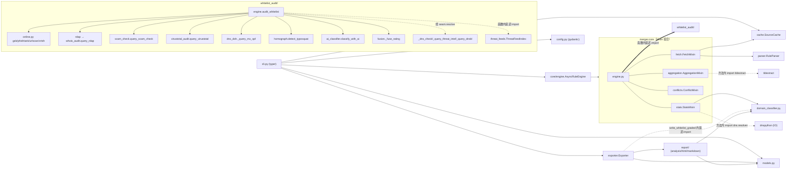
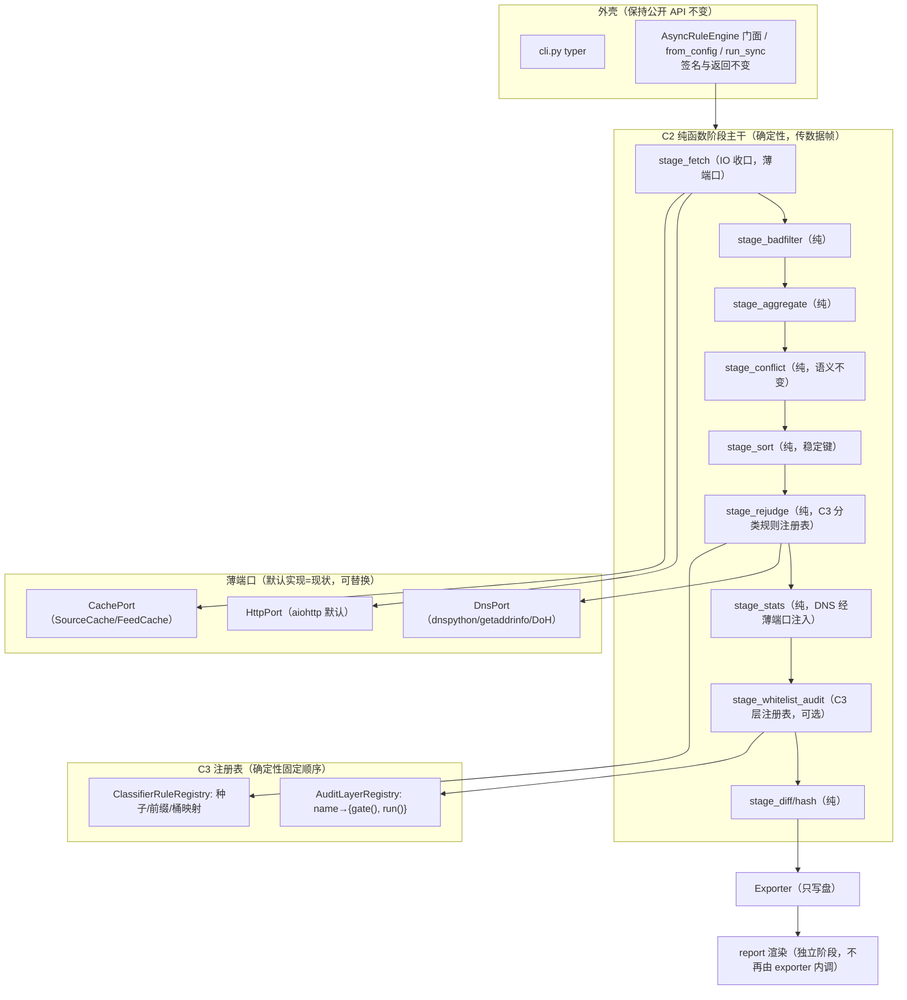
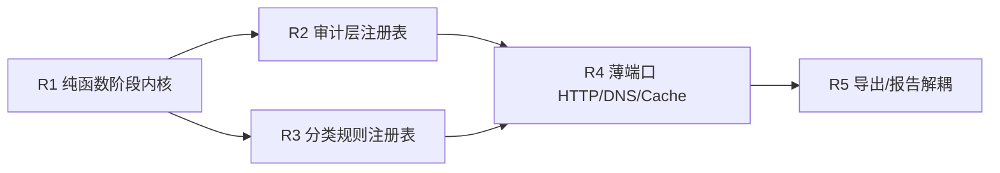

# AdGuard Rules Merger V7 纯架构评审报告（ARCHITECTURE-REVIEW）

> 本报告为**纯架构评审**：不改动任何生产代码、不联网抓取、不提交 git。所有内部现状论断均基于对仓库内真实源码（`merger/` 包）逐文件阅读得到的 `import`、函数、分支与常量；外部流派仅按名称引用，不引用任何外部 URL。

---

## 0. 元信息

| 项 | 值 |
|---|---|
| 产品版本 | `7.0.0`（唯一事实源 `merger/version.py::__version__`，由 `tests/test_version_consistency.py` 守护） |
| 评审日期 | 2026-10-21（Asia/Shanghai） |
| 基线测试 | `pytest tests/` → **409 passed / 3 deselected**（3 个 `@pytest.mark.slow` 用例按 `addopts = "-m 'not slow'"` 去选；本次离线复跑退出码 0，全绿） |
| 配置闸门 | `python -m merger validate config/sources.yaml` → **18/18 enabled**，退出码 0 |
| 评审范围 | 仅架构（模块边界、依赖方向、耦合点、演进路径），**不改行为、不改字节产物** |
| 运行时三方依赖（源码实测） | `aiohttp`（抓取/DoH/在线层）、`pydantic`+`pyyaml`（配置）、`typer`（CLI）、`tldextract`（PSL 抽取）、`dnspython`（可选，缺失时回退 `getaddrinfo`）；`requests`/`rich` 仅在 `pyproject.toml` 声明，`merger/` 内未实测到 import |
| 明确不做 | 不改 `.py`、不改 `pyproject.toml`、不改 `config/`、不改 CI；不联网；不 git commit；不新建除本文件外的任何产物 |

**评审方法说明**：用 AST 静态统计了每个模块行数与每个函数长度；所有耦合边均来自真实 `from ... import` / 函数体内延迟 `import`；所有“默认关 / 缺 key skip / 失败回退”论断均回到对应分支源码核对，未照抄二手描述。

---

## 1. 视角 A：内部现状剖析

### 1.1 运行时数据流（基于 `core/engine.py::AsyncRuleEngine.run` 真实顺序）

```mermaid
flowchart TD
    YAML["config/sources.yaml<br/>load_config() pydantic 校验<br/>(config.py)"] --> CFG["MergeConfig"]
    CFG --> FROMCFG["AsyncRuleEngine.from_config(cfg)<br/>(core/engine.py:200)"]

    subgraph FETCH["阶段0 抓取（IO，FetchMixin）"]
        A1["fetch_all() 并发信号量<br/>(core/fetch.py:277)"]
        A2["_fetch_text() ETag/304/SHA256<br/>负缓存 + 硬 deadline + 退避<br/>失败回退陈旧缓存"]
        A3["_fetch_one() parsed-cache 命中<br/>否则 run_in_executor 解析"]
        A1 --> A2 --> A3
    end

    FROMCFG --> FETCH
    A3 --> MAPS["block_map / allow_map /<br/>regex_blocks / regex_allows<br/>(key=(normalized_domain, wildcard, modifiers))"]

    MAPS --> BF["_apply_badfilter() 取消 badfilter 及其目标<br/>(core/aggregation.py:18)"]
    BF --> AGG{"aggregation_enabled?"}
    AGG -- 是 --> AGG2["_aggregate() 精确归并 + 通配子域归并<br/>+ 可选 wildcard 升级(count/pattern)<br/>(core/aggregation.py:101)"]
    AGG -- 否 --> AGG2b["原样保留 block_map.values()"]
    AGG2 --> CRES
    AGG2b --> CRES

    CRES{"conflict_resolution_enabled?"}
    CRES -- 是 --> CRES2["_resolve_conflicts()<br/>exact → wildcard 父域 → cascade 父域<br/>$important 跳过<br/>(core/conflicts.py:18)"]
    CRES -- 否 --> CRES2b["不做抑制"]
    CRES2 --> SORT["稳定排序 Rule.sort_key<br/>(类型→域名→wildcard→modifiers→raw)"]
    CRES2b --> SORT

    SORT --> SEED{"classification_enabled 且 seed_file?"}
    SEED -- 是 --> SEEDM["merge_seed_map(load_seed_file())<br/>写入模块全局 _REGISTERED_LOOKUP<br/>(engine.py:360-361)"]
    SEED -- 否 --> REJ2
    SEEDM --> REJ2["_rejudge_block_categories()<br/>未启用则 no-op；启用时离线高置信0.9注册域精确匹配才移桶<br/>安全桶不降级 / CNAME rescue(可选)<br/>(core/stats.py:217, engine.py:362)"]
    REJ2 --> STATS["_compute_stats() 贡献度/重叠矩阵<br/>_compute_modifier_stats()<br/>(core/stats.py:35/151)"]

    STATS --> AUDIT{"whitelist_audit_enabled?"}
    AUDIT -- 是 --> WA["audit_whitelist(final_allows,...)<br/>多层并行融合 (whitelist_audit/engine.py:43)"]
    AUDIT -- 否 --> DIFF
    WA --> DIFF{"diff_against?"}
    DIFF -- 是 --> DIFF2["比对旧文件 added/removed"]
    DIFF -- 否 --> HASH
    DIFF2 --> HASH["SHA-256 content_version[:12]"]
    HASH --> OUTCOME["MergeOutcome 数据类<br/>(core/outcome.py:70)"]
    OUTCOME --> EXP["Exporter.export_all()<br/>(exporter.py:460)"]
```

关键顺序事实（`core/engine.py::run`，277–489 行实测）：

1. `fetch_all` 先聚合四张 map；失败率 `fail_threshold` 超限直接 `RuntimeError` 中止（300–307 行）。
2. `badfilter` 取消 →（可选）`_aggregate` →（可选）`_resolve_conflicts` → 稳定排序 → **离线重判在统计之前**（360–366 行，使桶计数反映新桶）→ `_compute_stats` →（可选）白名单审计 →（可选）diff → `content_version`。
3. 白名单审计只作用于 `final_allows`（409–413 行），不回写 block 列表；它产出的是报告/分级证据，不参与 block 抑制。
4. `whitelist_audit` 在 `run()` 函数体内**延迟 import**（371 行 `from ..whitelist_audit import AuditConfig, audit_whitelist`），是规避导入期耦合的防御写法。

### 1.2 依赖方向图（基于真实 import 边）

#### 实测耦合点

1. **core 内 fetch ↔ engine 的 Mixin 紧耦合（非字面 import 环，而是共享 `self` 隐式契约）**
   - `core/engine.py:34` `class AsyncRuleEngine(FetchMixin, AggregationMixin, ConflictMixin, StatsMixin)`。
   - `core/fetch.py:23-24` 仅在 `TYPE_CHECKING` 下引用 `AsyncRuleEngine`，运行时不反向 import，因此**不存在导入期硬环**；但 `FetchMixin` 直接读写 `self._session / self.cache / self._parser_kwargs / self.pattern_dropped ...`（fetch.py 全文），这些属性由 `engine.__init__` 建立。Mixin 与引擎之间没有显式接口/基类契约，靠鸭子类型共享同一批可变实例字段。

2. **stats 把 DNS IO 落进业务统计/重判 mixin**
   - `core/stats.py:174-207` `_resolve_cname_hints_sync` 在方法体内 `import dns.resolver`（182 行）并发起阻塞 CNAME 链查询（`resolver.resolve(current, "CNAME")`，199 行），由 `_resolve_cname_hints` 丢进 executor；调用点 `_rejudge_block_categories`。纯业务 mixin 内联了第三方 DNS 客户端，没有端口抽象。

3. **exporter 同时承担“写文件”与“调用 report 渲染”，并二次穿透到分类标签**
   - `exporter.py:45` `from .report import analyze_rules, generate_html_report, generate_markdown_report`；`write_report`（436–450）在导出器内部直接驱动 HTML/MD 渲染。
   - `write_whitelist_graded`（369 行）函数内延迟 `from .domain_classifier import CATEGORY_LABELS, CATEGORY_ORDER`，使“导出”再依赖“分类法”。

4. **whitelist_audit/engine 硬编码具体层，仅部分经 seam**
   - 直接 import 并调用具体层：`online._query_gsb/_query_phishtank/_query_urlscan/_query_crtsh`（engine.py:35, 194–207）、`rdap._query_rdap_wrapper`（36,172）、`scam_check.query_scam_check`（19,176）、`virustotal_audit.query_virustotal`（20,184）、`dns_doh._query_mx_spf`（32,189）、`homograph.detect_typosquat`（17,294）、`ai_classifier.classify_with_ai`（15,330）。
   - 仅 `_dns_check`、`_query_threat_intel`、`_query_dnsbl`（及其下游 `_dnsbl_lookup`、`_doh_lookup`、`_query_urlhaus/_query_threatfox`）经 `seam.resolve(name)` 在调用时从包命名空间解析（seam.py:16-19），以兼容测试里的 `monkeypatch.setattr(wa, "_dns_check", fake)`。**其余层没有同样的可替换接缝。**

5. **门面再导出的副作用**
   - `whitelist_audit/__init__.py` 把全部子模块私有函数（`_query_gsb` 等）再导出到包命名空间；`core/__init__.py`、`report/__init__.py`、根 `merger/__init__.py` 同理。seam 依赖“包属性存在”这一再导出结果，一旦子模块改名/不再经门面导出，`resolve()` 与既有 monkeypatch 接缝会静默失效。
   - 顶层兼容 shim：`merge_rules.py` → `merger.cli.app`；`config_loader.py` 再导出 `merger.config` 全套符号。

### 1.3 量化：模块行数 / 职责数 / 巨型函数 / 分支链

#### 1.3.1 模块行数（AST/实读统计，仅 `merger/`，不含 `build/lib` 副本）

| 模块 | 行数 | 职责数（粗分） |
|---|---:|---|
| `domain_classifier.py` | 1008 | 内置规则表 + 种子加载/合并 + PSL 抽取 + 置信判定 + 9 类→6 桶映射 |
| `whitelist_audit/engine.py` | 587 | 审计编排 + 每层门控 + 结果聚合 + summary 分桶 + 异常兜底 |
| `report/html.py` | 558 | 单函数 HTML 渲染（图表/矩阵/层表/审计段） |
| `exporter.py` | 498 | 7 种文本格式写盘 + 分层子集 + stats/conflicts/contributions JSON + 白名单分级 + 报告调度 + 内存释放 |
| `core/engine.py` | 496 | 40+ kwarg 构造 + from_config 装配 + run 编排 + run_sync |
| `parser.py` | 432 | 8 条正则分发 + 修饰符裁剪 + 质量过滤 + sidecar 序列化 |
| `config.py` | 392 | 11 个 pydantic 模型 + 默认值 + 校验器 + load/validate/resolve_api_keys |
| `report/markdown.py` | 386 | 单函数 Markdown 渲染 |
| `models.py` | 365 | Rule/SourceMeta + 类别优先级 + 位掩码注册表 + 规范化 + 排序键 |
| `core/fetch.py` | 352 | session 管理 + 条件请求 + 重试退避 + 负缓存 + parsed-cache + 并发归并 |
| `cache.py` | 347 | ETag/304 + SHA256 + parsed pickle sidecar + 淘汰 |
| `homograph.py` | 336 | 同形字折叠表 + 编辑距离品牌匹配（纯离线） |
| `cli.py` | 285 | 5 个 typer 命令 + 缓存子命令 |
| `report/analysis.py` | 273 | analyze_rules + 共享着色/矩阵/层表辅助 |
| `core/stats.py` | 271 | 贡献度 + 重叠矩阵 + 修饰符统计 + CNAME IO + 离线重判 |
| `core/aggregation.py` | 238 | badfilter 取消 + 精确/通配归并 + 升级 |
| 其余（fusion/disk_cache/threat_feeds/各在线层等） | 合计 ~1500 | 单一职责为主 |

#### 1.3.2 巨型函数候选（AST 实测函数行数）

| 函数（文件::函数） | 行数 | 问题 |
|---|---:|---|
| `whitelist_audit/engine.py::audit_whitelist` | 545（含嵌套 `_audit_one` 327） | 编排 + 建 session + 喂层 + 融合 + summary 全在一个函数；嵌套闭包持有 `layer_hits/ai_budget/fresh_disk` |
| `report/html.py::generate_html_report` | 535 | 一个函数拼整页 HTML，多段字符串拼接 |
| `report/markdown.py::generate_markdown_report` | 368 | 同上，Markdown 版 |
| `whitelist_audit/engine.py::_audit_one`（嵌套） | 327 | 12 个 `if config.use_*` 门控 + 12 个默认 dict 解构 + 结果字段平铺 |
| `core/engine.py::run` | 213 | 串起抓取/取消/聚合/冲突/排序/重判/统计/审计/diff/哈希 |
| `core/engine.py::__init__` | 161 | 40+ 参数透传赋值 |
| `whitelist_audit/fusion.py::_fuse_rating` | 171 | 14 个信号 `if` 累加 + 四级 rating 返回 |
| `core/aggregation.py::_aggregate` | 138 | 升级 + 精确归并 + 通配归并三段耦合在一个方法 |
| `parser.py::parse_stream` | 136 | 8 条正则顺序分发的长 if 链 |
| `core/fetch.py::_fetch_text` | 132 | 本地文件/负缓存/304/重试/deadline/陈旧回退多分支 |

#### 1.3.3 if/elif 层链与开关分支（实测位置）

- **审计层门控链**：`whitelist_audit/engine.py::_audit_one`，156–207 行连续 `if config.use_dns / (use_urlhaus or use_threatfox) / use_rdap / use_scam_check / use_dnsbl / (use_virustotal and key) / use_dns_mx / (use_gsb and key) / (use_phishtank and key) / use_urlscan / use_crtsh`，每个分支各自 `tasks.append(...)` + `task_names.append(...)`。新增一层需要同时改：门控、gather 解构、默认 dict、`layer_hits` 计数、结果字段、`_fuse_rating`、`layers_enabled`、报告层表。
- **分类置信阈值分支**：`core/stats.py::_rejudge_block_categories`（217 行起）：`classification_enabled` 早退 → 安全桶 `_SECURITY_BUCKETS` 跳过（235–236）→ `confidence < CONFIDENCE_REGISTERED(0.9)` 且开 CNAME 才 rescue，且 rescue 要求 cconf 同样 ≥0.9（240–244，0.72 的 CNAME 折扣仍被拒）→ `classification_registered_only` 二选一（`block_bucket_for` 247 vs `BLOCK_BUCKET_MAP.get` 249）。
- **安全桶不降级**：`stats.py:168` `_SECURITY_BUCKETS={malware,phishing,mining}`，236 行 `continue`；`domain_classifier.block_bucket_for`（915 行）置信 `< CONFIDENCE_REGISTERED(0.9)` 直接返回 `None`，CDN/支付/隐私不在 `BLOCK_BUCKET_MAP`。
- **冲突三级匹配链**：`core/conflicts.py:54-67` exact → wildcard 父域 → cascade 父域；`$important` 在 50–51 行直接 `continue`。
- **聚合开关**：`engine.run` 的 `aggregation_enabled`/`conflict_resolution_enabled`/`classification_enabled`/`whitelist_audit_enabled`/`diff_against` 五个独立 if。
- **退避策略**：`fetch.py:175-178` `backoff == "exponential"` 线性/指数二选一。

#### 1.3.4 潜在循环依赖 / 全局可变状态风险点

- **字面导入环：实测无**。`whitelist_audit` 不反向 import `core`；`report` 不 import `exporter`；延迟 import 进一步隔离。风险不在导入环，而在**Mixin 隐式 self 契约**与**模块级全局可变表**。
- `models.py:103-115` 模块级 `_SOURCE_TO_BIT/_BIT_TO_SOURCE` 进程内累积，`intern_source` 只增不清；多次 run/测试共享同一注册表（当前靠 key 不冲突规避）。
- `domain_classifier.py:756` `_REGISTERED_LOOKUP` 为模块全局，`merge_seed_map`（862–874）在 `run()` 时运行时写入；跨 run 外部种子会累积（setdefault，手写优先），属于进程级可变单例。
- 配置权重双源且部分失配：`config.py:33-49` `DEFAULT_FUSION_WEIGHTS` 的键（`dnsbl`/`virustotal`/`ai`/`safe_signal`/`age_young`/`dnsbl_spam`）与 `fusion.py` 实际 `w.get(...)` 读取的键（`threat_intel`/`dnsbl_malicious`/`dnsbl_listed`/`scam_confirmed`…）不完全重合；YAML 里若干权重当前是“死配置”，且同名键数值两处不一致（如 `threat_intel` 95 vs fusion 默认 40）。这是配置漂移，不影响默认字节，但会误导调参。

### 1.4 已有测试护栏（409 用例覆盖到的地方）

| 护栏主题 | 对应测试文件 | 守住的不变量 |
|---|---|---|
| 字节确定性 | `test_determinism.py`（两次 run_sync+export 比对 sha256，禁时间戳） | 同输入两产物字节一致 |
| 解析 | `test_parser.py` | 正则/hosts/修饰符/质量过滤 |
| 去重等价 | `test_dedup_equivalence.py` | exact/normalized/regex 归并计数 |
| 聚合 | `test_aggregation.py` | 精确/通配/升级/白名单子域不被吞并 |
| badfilter | `test_badfilter.py` | 取消且不被升级重建 |
| 冲突 | `test_conflicts.py` | exact/wildcard/cascade，`$important` 不被抑制 |
| 离线分类 | `test_classifier.py` / `test_classification_seeds.py` / `test_block_classification.py` | 0.9 注册域才移桶、安全桶不降级、CNAME 折扣拒绝 |
| 缓存 | `test_cache.py` | ETag/哈希/parsed sidecar |
| DNS/DoH | `test_dnsx.py` / `test_doh.py` | NXDOMAIN 判定、DoH 失败回退（monkeypatch `DnsChecker.check`/`_doh_lookup`） |
| 同形字 | `test_homograph.py` | 纯离线品牌匹配阈值 |
| 审计层 | `test_audit_layers.py` / `test_audit_enrichment.py` / `test_report_layers.py` | 各层空 key 跳过、融合、seam monkeypatch |
| 威胁馈送 | `test_threat_feeds.py` | 数据集 O(1) 查找 + API 回退 |
| 回归固化 | `test_v52_fixes.py` / `test_v7.py` | 历史修复点不回潮 |
| CLI 端到端 | `test_cli_e2e.py` | CliRunner 本地文件，无网络 |
| 配置校验 | `test_config_validate.py` | Literal/URL/类别校验 |
| 版本一致 | `test_version_consistency.py` | 7.0.0 / UA / 磁盘格式版本 |

**护栏盲区**：审计编排器 `_audit_one` 内直连的 `gsb/phishtank/urlscan/crtsh/rdap/scam/vt/mxspf/homograph/ai` 没有以“替换编排内调用”的方式被 monkeypatch，测试多为直接调用空 key 函数或离线纯函数；因此这些层在编排器内的接线目前缺少接缝级测试。

---

## 2. 视角 B：外部成熟模式对照（通用架构模式，仅名称/流派）

> 以下均为通用架构模式，不引用具体文献 URL。适配度结合本项目约束：**离线优先、单进程 CLI、可选在线层、YAML 配置驱动、Docker/CI、字节确定性**。

| 模式 | 核心思想 | 在本项目适配度 | 理由（结合实测） |
|---|---|---|---|
| **分层架构（Layered Architecture）** | 高层策略不依赖低层细节，单向依赖；每层只调下一层 | **高（现状已近似）** | 现状已是 cli→engine→{parser/cache/classifier}、exporter→report 的单向分层；缺口仅在 Mixin 共享 self、exporter 越层调 report、stats 内联 DNS。补齐边界即可，成本低。 |
| **显式阶段管线（Stage Pipeline / 纯函数组合）** | 把处理拆成有序纯函数阶段，阶段间传不可变数据帧，IO 收口在两端 | **高（推荐主干）** | 现有 `run()` 顺序（抓取→取消→聚合→冲突→排序→重判→统计→审计→导出）天然是阶段；多数阶段（取消/聚合/冲突/排序/统计）已是纯逻辑，只需抽成接收/返回数据帧的函数，确定性天然保持。 |
| **插件/策略注册表（Registry / Strategy）** | 能力以 `name→callable` 注册，配置按名选取；新增能力不改编排主干 | **高（推荐用于审计层与分类规则）** | 审计 12 个层、分类规则表都是“可枚举策略”；现状 `if config.use_*` 链正是注册表要替代的硬编码。seam.resolve 已是雏形，可演进为正式注册表。 |
| **六边形 / 端口适配器（Ports & Adapters）** | 业务核心定义端口接口，IO（HTTP/DNS/缓存）做成可替换适配器 | **中（只取“薄端口”，不做完整六边形）** | 项目确有 HTTP/DNS/缓存三类外围，但核心逻辑体量小、单进程、无多部署环境替换需求；完整六边形的接口/适配器双层会显著抬高演进成本，冲击公开 API，仅对 DNS/HTTP/cache 做薄接口即可。 |
| **事件驱动（Pub/Sub）** | 组件发布事件、订阅者异步响应，松耦合 | **低（排除）** | 本项目要求**字节确定性与单次 CLI 批处理**；异步 fan-out 的完成顺序、回调时序会引入非确定性，且现有 `asyncio.gather` 已足够，引入事件总线只增加复杂度与测试难度，无收益。 |

---

## 3. 视角 C：演进约束分析（硬约束 → 对架构选型的限制）

| # | 硬约束（源码/配置实测） | 对架构选型的限制 |
|---|---|---|
| C1 | **默认产物逐字节不变**：`report_timestamp=False`（exporter.py:87,292,341；analysis.py `_generation_label`），不写墙钟；同输入 sha256 一致（test_determinism.py） | 排除任何依赖字典遍历顺序、集合迭代、墙钟、随机数的新结构；阶段必须显式排序；注册表遍历顺序需确定性固定。事件驱动（完成顺序不确定）直接出局。 |
| C2 | **白名单单独提取**：`whitelist.txt`（exporter.write_whitelist:198）+ 分级 `whitelist_{rating}.txt` / `whitelist_by_category/`（write_whitelist_graded:363） | 导出阶段必须保留 block/allow 双轨与分级写入；重构不能合并两条输出流；分级依赖审计结果字段，接口需保留。 |
| C3 | **冲突不误删 block**：`_resolve_conflicts` 只按 exact/wildcard 父域/cascade 父域覆盖，`$important` 跳过（conflicts.py:50-67）；不得把被白名单覆盖的 block 当多余项删除、不得扩大抑制范围 | 冲突阶段必须保持现有匹配语义与优先级；不能借“重构”放宽到后缀泛匹配；该阶段适合做成带完整测试的纯函数，禁止引入模糊规则引擎。 |
| C4 | **在线层默认关、缺 key skip、失败回退不阻断**：`use_gsb/phishtank/urlscan/crtsh/vt/ai` 默认 False；硬需 key 的层缺 key 返回 `error="no API key configured"`（online.py:24 gsb、64 phishtank；virustotal_audit.py:59；ai_classifier.py:81），urlscan 的 key 为可选、crtsh 免 key；每层 try/except 降级为 error dict；`asyncio.gather(..., return_exceptions=True)`（whitelist_audit/engine.py:453）兜底 | 注册表条目必须自带“门控判定（enabled 且按层要求有 key）”与“失败降级”契约；离线默认路径不得触碰网络；不能让某层异常拖垮整轮。 |
| C5 | **离线可测**：测试 monkeypatch 网络/时间/随机；无真实 HTTP/DNS（test_cli_e2e.py 注释、seam 设计初衷） | 所有 IO 必须可替换；保留现有 monkeypatch 接缝（`_dns_check` 等经包属性）；新抽象不能破坏既有 patch 点。 |
| C6 | **公开 API / console script 不变**：`merger.core.AsyncRuleEngine / from_config / run_sync`、`merger.whitelist_audit.audit_whitelist`、`merger.report.*`、`merger.exporter.Exporter`、console `adguard-rules-merger`、`python -m merger merge/validate/version` | 重构只能“包装/抽取”，不得改签名、删符号、改返回结构；门面再导出必须保留；新内部模块不得要求用户改调用。 |
| C7 | **闸门：pytest 只增不减 / ruff check / ruff format --check / python -m build / validate 18/18** | 每轮迭代必须全绿；不得为重构放宽 lint；不引入新第三方依赖（uv.lock 不动）。 |
| C8 | **uv.lock / 版本 7.0.0 / User-Agent 不动** | 不得新增/升级依赖；`version.py` 常量与 UA 保持；磁盘格式版本号（SIDECAR/CACHE/AUDIT_CACHE）不得无故 bump。 |
| C9 | **CI 离线、单进程批处理、Docker 发布** | 排除需要常驻服务、消息中间件、运行时反射插件加载的方案；保持单 wheel、零外部服务。 |

---

## 4. 候选架构对比与评分

### 4.1 权重表（合计 100%）

| 维度 | 权重 | 权重理由 |
|---|---:|---|
| D 确定性/可复现 | 20% | 本项目第一红线（C1 字节稳定），权重最高 |
| T 可测试性与离线 | 18% | CI 离线、409 用例全靠 monkeypatch，是日常回归命脉（C5/C7） |
| E 演进成本（增量、不破公开 API/字节） | 15% | 要求每轮可独立发布、可 revert（C6/C7/C8） |
| I IO 与业务解耦 | 15% | 当前最大技术债来源（stats 内联 DNS、exporter 调渲染） |
| P 在线层可插拔 | 12% | 在线层持续增减，硬编码 if 链已难维护（C4） |
| C 配置驱动/易扩展新源 | 12% | YAML 已是事实配置中心，新层/新源应配置可达 |
| X 部署复杂度（越简单分越高） | 8% | 单 CLI/单 wheel，重架构反而扣分（C9） |

### 4.2 评分矩阵（1–5 分；加权分 = 分数 × 权重）

| 候选 | D 20% | T 18% | E 15% | I 15% | P 12% | C 12% | X 8% | **加权总分** |
|---|---:|---:|---:|---:|---:|---:|---:|---:|
| **C2 显式阶段管线** | 5 | 5 | 4 | 4 | 3 | 4 | 5 | **4.34** |
| **C3 插件/策略注册表** | 4 | 4 | 4 | 3 | 5 | 5 | 4 | **4.09** |
| C4 六边形/端口适配器（完整） | 4 | 5 | 2 | 5 | 5 | 4 | 2 | 3.99 |
| C1 现状分层（Mixin+门面） | 5 | 4 | 5 | 2 | 2 | 3 | 5 | 3.77 |
| C5 事件驱动 pub/sub（排除项） | 2 | 2 | 1 | 3 | 4 | 3 | 2 | 2.36 |

加权计算明细（分数×权重）：

- **C2**：5·.20=1.00，5·.18=.90，4·.15=.60，4·.15=.60，3·.12=.36，4·.12=.48，5·.08=.40 → **4.34**
- **C3**：4·.20=.80，4·.18=.72，4·.15=.60，3·.15=.45，5·.12=.60，5·.12=.60，4·.08=.32 → **4.09**
- **C4**：4·.20=.80，5·.18=.90，2·.15=.30，5·.15=.75，5·.12=.60，4·.12=.48，2·.08=.16 → **3.99**
- **C1**：5·.20=1.00，4·.18=.72，5·.15=.75，2·.15=.30，2·.12=.24，3·.12=.36，5·.08=.40 → **3.77**
- **C5**：2·.20=.40，2·.18=.36，1·.15=.15，3·.15=.45，4·.12=.48，3·.12=.36，2·.08=.16 → **2.36**

**排序：C2（4.34）> C3（4.09）> C4（3.99）> C1（3.77）> C5（2.36）。**

### 4.3 各候选评述

**C1 现状分层（Mixin + 门面）— 3.77**
- 优势：零迁移成本，公开 API 与字节产物已稳定，演进成本/部署两项满分。
- 代价/风险：在线层硬编码 if 链（P=2）、IO 泄漏进业务（I=2）；新增审计层要改 7 处；Mixin 隐式 self 契约长期难以测试。
- 红线契合：完全符合 C1/C6/C8，但在 C4（在线层可插拔）上持续欠债。

**C2 显式阶段管线 — 4.34（推荐主干）**
- 优势：把 `run()` 已有顺序抽成纯函数阶段，确定性满分；每阶段可单测；IO 收口在抓取阶段与导出阶段。
- 代价/风险：阶段间数据帧（可复用现有 `MergeOutcome`/四张 map）需要小心保持不可变；对“在线层插拔”仅给 3 分，因为管线本身不解决策略注册。
- 红线契合：C1/C3/C5/C6 天然满足；可在不动门面的前提下增量包裹现有 Mixin。

**C3 插件/策略注册表 — 4.09（推荐用于审计层 + 分类规则）**
- 优势：在线层可插拔、配置驱动两项满分；新增层只需注册一条目；seam.resolve 已是雏形。
- 代价/风险：注册表本身不解耦 IO（I=3）；需保证注册顺序确定性（C1），避免 dict 顺序泄漏；要兼容既有 monkeypatch。
- 红线契合：C4 直接满足；只要注册顺序固定、默认关闭，不碰字节。

**C4 完整六边形/端口适配器 — 3.99（只取薄端口，不做全套）**
- 优势：IO 解耦满分、可测试满分。
- 代价/风险：对一个单进程 CLI 引入全套端口/适配器双层，演进成本仅 2 分，冲击公开 API 风险高，部署复杂度上升；收益相对现有规模过剩。
- 红线契合：I/T 好，但 E（演进）与 X（部署）与 C6/C7 冲突。

**C5 事件驱动 pub/sub — 2.36（明确排除）**
- 优势：订阅式加层看似松耦合（P=4）。
- 代价/风险：异步事件完成顺序破坏字节确定性（D=2）、离线 hermetic 测试困难（T=2）、单 CLI 引入总线纯属过重（X=2/E=1）。
- 红线契合：与 C1（确定性）、C9（单进程）直接冲突，排除。

### 4.4 推荐组合与目标架构

**推荐：C2 显式阶段管线为主干 + C3 注册表承载审计层/分类规则 + 对 HTTP/DNS/缓存仅做“薄端口”，不做完整六边形，不引入事件总线。**

- **主干阶段保持纯函数/确定性**：S1–S6、S8 不触网、不读墙钟、不读全局随机；输入数据帧 → 输出新数据帧；排序键沿用 `Rule.sort_key`。
- **注册表承载在线层与分类规则**：审计每条目自带 `gate(config)`（enabled 且有 key）与 `run(domain, session, ports)`，失败返回 error dict；遍历顺序在注册表内固定声明，保证确定性。分类规则（内置种子/前缀/桶映射）从模块全局表迁入可构造的规则集，消除运行时写全局。
- **薄端口包住 HTTP/DNS/cache**：只定义最小调用接口，默认实现包装现有 aiohttp/dnspython/SourceCache；测试注入 fake，不搞全套适配器分层。

---

## 5. 五次可迭代演进路线（每轮独立成文、独立可发布、行为保持、可单独提交）

> 顺序原则：先抽纯函数内核（打地基、零行为风险）→ 再审计注册表 → 再分类注册表 → 再薄端口 → 最后解耦导出/报告。每轮都可独立停止，不承诺一次到位。

### R1 — 抽取纯函数阶段内核（不动 IO，不改门面）

- **迭代目标**：把 `core/engine.py::run` 内已有的纯逻辑段抽成模块级纯函数，`AsyncRuleEngine.run` 仅负责编排调用，公开签名/返回不变。
- **涉及模块/改动点（落到真实位置）**：
  - 新增内部 `core/stages.py`（或在现有 mixin 内提函数）：`apply_badfilter(block_map, allow_map)`（包 `aggregation._apply_badfilter`）、`aggregate(block_map, allow_domains, cfg)`（包 `_aggregate`）、`resolve_conflicts(blocks, allows, source_names, cfg)`（包 `_resolve_conflicts`）、`sort_rules(blocks, allows, regex_*)`、`rejudge(blocks, classifier, dns_port=None)`（包 `_rejudge_block_categories`）、`compute_stats(...)`（包 `_compute_stats/_compute_modifier_stats`）。
  - `engine.run` 改为顺序调用这些函数，不改变分支条件与计数。
- **不破坏的不变量**：C1 字节、C3 冲突语义、C6 `AsyncRuleEngine` API；计数与 `MergeOutcome` 字段完全一致。
- **验收闸门**：`pytest` 409 只增不减（可补纯函数单测）、`ruff check`、`ruff format --check`、`python -m build`、`validate` 18/18；`test_determinism.py` 必须仍绿。
- **回滚**：`git revert` 单提交（纯抽取，无行为 diff）。
- **风险与缓解**：抽函数时误把 `self` 可变状态带进纯函数 → 先只搬无 IO 段，CNAME/审计留到 R4/R2。

### R2 — 审计层注册表（替代 `_audit_one` 的 if 链，保留 seam）

- **迭代目标**：把 `_audit_one` 内现有门控层（gather 内 11 个任务：dns/threat_intel/rdap/scam/dnsbl/vt/mxspf/gsb/phishtank/urlscan/crtsh，加同步 heuristics/homograph 与后置 ai）登记为 `AuditLayerRegistry` 条目，`gate()` 决定是否入队，`run()` 返回既有默认 dict 形状；编排器只 `gather` 已启用层。
- **涉及模块/改动点**：
  - 新增 `whitelist_audit/registry.py`：`LayerSpec(name, gate, run, offline: bool)`；把 `engine._audit_one`（156–207）的门控与调用迁到各层条目；`_fuse_rating` 签名保持。
  - 保留 `seam.resolve` 对现有可 patch 名的解析（`_dns_check/_query_threat_intel/_query_dnsbl`），注册表条目默认指向原函数，monkeypatch 仍命中。
- **不破坏的不变量**：C4 默认关/缺 key skip/失败回退；审计输出 dict 字段与 summary 分桶不变（C2 分级依赖）；离线测试 hermetic。
- **验收闸门**：`test_audit_layers.py / test_audit_enrichment.py / test_report_layers.py` 全绿；pytest 只增不减；ruff/build/validate 通过。
- **回滚**：`git revert` 单提交。
- **风险与缓解**：注册顺序非确定导致输出顺序漂移 → 注册表用声明式有序列表，`asyncio.gather` 结果按固定 `task_names` 归位（现状已是如此，保持）。

### R3 — 分类规则注册表（收敛模块全局可变表）

- **迭代目标**：把 `domain_classifier` 的内置注册域表/前缀表/种子/`BLOCK_BUCKET_MAP`/置信阈值封装为可构造的 `ClassifierRuleSet`，消除 `merge_seed_map` 对模块全局 `_REGISTERED_LOOKUP` 的运行时写入。
- **涉及模块/改动点**：
  - `domain_classifier.py`：`_REGISTERED_LOOKUP/_PREFIX_LOOKUP` 改为规则集实例携带；`classify_domain_with_confidence(domain, cname_hints, ruleset=None)` 保持默认行为；`merge_seed_map` 改为返回新规则集而非写全局。
  - `core/stats._rejudge_block_categories` 持有规则集实例；安全桶不降级、0.9 阈值、CNAME 0.72 拒绝等分支原样保留。
- **不破坏的不变量**：C1 默认（classification_enabled=False）零行为；安全桶不降级；CDN/支付/隐私不移桶。
- **验收闸门**：`test_classifier/test_classification_seeds/test_block_classification` 全绿；其余不受影响；闸门全套。
- **回滚**：`git revert` 单提交。
- **风险与缓解**：默认规则集需与现状内置表逐项一致 → 先用现有表构造默认实例，补一条“默认实例 == 旧全局”的断言测试。

### R4 — 薄端口包住 HTTP / DNS / 缓存（IO 注入）

- **迭代目标**：为 HTTP session、DNS（dnspython/getaddrinfo/DoH）、缓存定义最小端口接口，默认实现包装现状；把 `stats._resolve_cname_hints_sync` 的直接 `dns.resolver`、各处内联 aiohttp 改为经端口。
- **涉及模块/改动点**：
  - 新增 `ports.py`（薄接口）：`HttpPort.get/post`、`DnsPort.resolve_cname/a/mx`、`CachePort`；默认实现分别包 aiohttp、`dnsx.DnsChecker`/`dns_doh`、`SourceCache/FeedCache`。
  - `core/stats.py:174-207` CNAME（`import dns.resolver` 在 182）改走注入的 `DnsPort`；`whitelist_audit` 各在线层经 `HttpPort`。
- **不破坏的不变量**：C5 离线可测（fake 端口）；C4 失败回退；不新增依赖（C8）。
- **验收闸门**：`test_dnsx/test_doh/test_cache` 全绿；pytest 只增不减；闸门全套。
- **回滚**：`git revert` 单提交。
- **风险与缓解**：端口抽象过度 → 只暴露现有方法用到的最小面，默认实现直接转发，不重写逻辑。

### R5 — 导出 / 报告解耦（Exporter 只写盘）

- **迭代目标**：`Exporter` 不再直接调用 `analyze_rules/generate_html/markdown`；报告作为独立阶段由门面/CLI 调用后把字符串交给导出器落盘；`write_whitelist_graded` 对 `domain_classifier` 的依赖上移。
- **涉及模块/改动点**：
  - `exporter.py::write_report`（436–450）改为接收已渲染好的 html/md 字符串；渲染调用移到编排层；`write_whitelist_graded:369` 的延迟 import 改为接收标签映射参数。
  - `report/*` 保持纯渲染，不反向依赖 exporter。
- **不破坏的不变量**：C2 白名单分级文件、字节稳定（report_timestamp 语义）；`Exporter` 公开方法尽量保留（新增可选参数，旧调用兼容）。
- **验收闸门**：`test_report_layers.py`、`test_determinism.py` 全绿；产物 sha256 不变；闸门全套。
- **回滚**：`git revert` 单提交。
- **风险与缓解**：`Exporter` 构造被外部直接使用 → 采用“新可选参数 + 旧路径委托”，不删旧签名。

#### 迭代依赖关系

R1 是 R2/R3 的共同地基；R2、R3 彼此独立可并行；R4 依赖 R2（层要经端口发 HTTP/DNS）与 R3（分类规则集便于注入端口）；R5 是叶子、最安全，放最后。每轮单独提交、单独可停。

---

## 6. 风险、回滚总表与结论

### 6.1 全局风险与缓解

| 风险 | 说明（实测依据） | 缓解 |
|---|---|---|
| 过度设计 | 完整六边形/事件总线对单 CLI 过剩（C4/C5 评分已体现） | 只做 C2 主干 + C3 注册表 + 薄端口，拒绝全套抽象 |
| 破坏字节确定性 | 注册表遍历顺序、全局表迁移可能引入顺序漂移（C1） | 声明式有序注册；默认实例与旧表对账；`test_determinism.py` 每轮必绿 |
| 在线层引入非确定性 | 并发 gather、墙钟、环境 DNS 影响默认路径（C4/C1） | 默认关；层内失败降级 error dict；墙钟只在 `report_timestamp` 出现 |
| registry 破坏 monkeypatch 接缝 | 现状仅 `_dns_check/_query_threat_intel/_query_dnsbl` 经 seam 可 patch（engine.py:157/167/180） | R2 保留 seam.resolve，注册表默认指向原包属性，patch 仍命中 |
| 配置权重漂移 | `config.DEFAULT_FUSION_WEIGHTS` 与 `fusion.w.get` 键部分失配（1.3.4） | 单列一次对账（可并入 R2），不改默认数值 |
| 全局可变状态 | `models._SOURCE_TO_BIT`、`domain_classifier._REGISTERED_LOOKUP` 进程级累积 | R3 收敛分类全局；位掩码注册表维持现状（风险低，不强行动） |
| 公开 API 回归 | 用户直接构造 `Exporter`/`AsyncRuleEngine`（C6） | 只加可选参数、保留门面，`test_cli_e2e` 守入口 |

### 6.2 回滚总表

| 轮次 | 回滚方式 | 预期代价 |
|---|---|---|
| R1–R5 每轮 | `git revert <单提交>` | 纯增量包裹，无数据迁移、无缓存格式变更，回滚即还原 |

### 6.3 结论（一句话）

**以“显式阶段管线（C2）”为确定性主干，叠加“审计/分类注册表（C3）”与最小 IO 薄端口，拒绝完整六边形与事件驱动，按 R1→R2/R3→R4→R5 增量演进，可在字节产物与公开 API 完全不变的前提下逐步卸下当前 Mixin 紧耦合与在线层硬编码债务。**

- **评分最高候选**：**C2 显式阶段管线，加权总分 4.34**（推荐组合为 C2 主干 + C3 注册表 + 薄端口）。
- **5 轮迭代标题**：
  1. R1 抽取纯函数阶段内核（不动 IO，不改门面）
  2. R2 审计层注册表（替代 `_audit_one` if 链，保留 seam）
  3. R3 分类规则注册表（收敛模块全局可变表）
  4. R4 薄端口包住 HTTP / DNS / 缓存（IO 注入）
  5. R5 导出 / 报告解耦（Exporter 只写盘）
