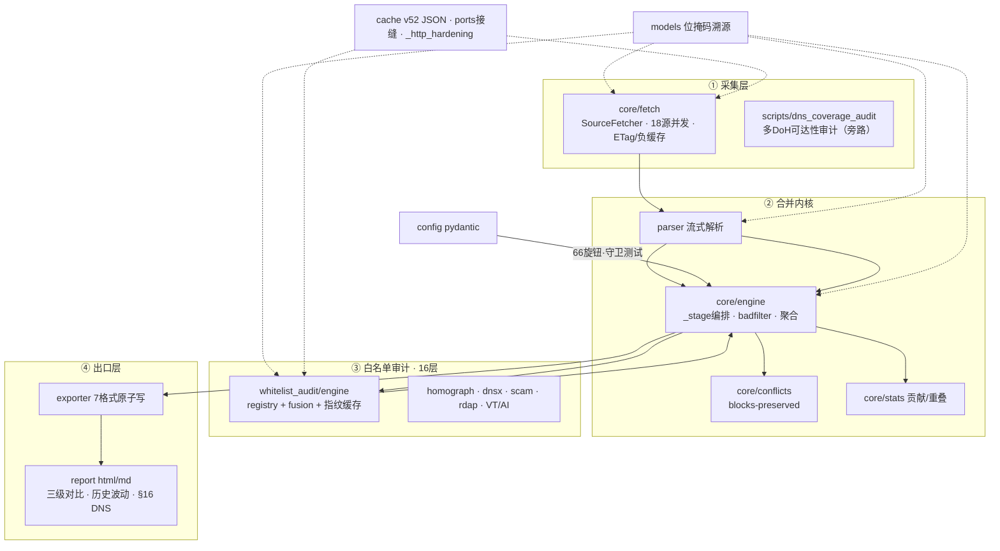

# 架构说明（Architecture）

本文档描述 AdGuard Rules Merger V8 的整体管线、模块职责、关键数据结构与设计取舍。
面向二次开发、代码评审与部署排障。

## 1. 总体数据流

```
config/sources.yaml
        │  load_config()（pydantic 校验）
        ▼
   MergeConfig
        │  AsyncRuleEngine.from_config(cfg)
        ▼
 ┌──────────────────────────────────────────────────────────────┐
 │                        AsyncRuleEngine                        │
 │                                                              │
 │  1. fetch_all()      异步并发下载（aiohttp，信号量限流）      │
 │       ├─ 负缓存跳过（negative cache）                        │
 │       ├─ 条件请求 If-None-Match / If-Modified-Since          │
 │       ├─ ETag/Last-Modified/SHA-256（SourceCache）           │
 │       ├─ 硬超时 source_deadline + 重试/退避                  │
 │       └─ 失败回退陈旧缓存；失败率超阈值则中止                 │
 │  2. parse_text()     流式解析（StringIO，逐行）→ Rule        │
 │  3. _dedup()         精确 + 规范化（小写/去尾点/可选去 www） │
 │                       + 正则去重                             │
 │  4. _aggregate()     向上聚合（精确/通配符子域/可选升级）    │
 │  5. 白名单分离       block / allow 分流                      │
 │  6. _resolve_conflicts()  allow 覆盖 block 并级联子域        │
 │  7. 白名单多层审计   audit_whitelist（8 层，按需）           │
 │  8. 稳定排序         先按类型，再按领域名字典序（确定性）    │
 └──────────────────────────────────────────────────────────────┘
        │  MergeOutcome（blocks / allows / counters / stats / audit）
        ▼
 ┌──────────────────────────────────────────────────────────────┐
 │                          Exporter                            │
 │  adguard / whitelist / hosts / domains / clash / surge /     │
 │  smartdns / 分层文件 / stats.json / conflicts.json /         │
 │  contributions.json / added / removed / report.html / .md   │
 │  （原子写入：*.tmp → replace；默认确定性）                   │
 └──────────────────────────────────────────────────────────────┘
```

编排入口在 `merger/core/engine.py` 的 `AsyncRuleEngine.run()`（异步）与
`run_sync()`（同步包装）。CLI 只负责装配配置、调用引擎、调用导出器。

## 2. 模块职责

| 模块 | 职责 |
|---|---|
| `merger/cli.py` | Typer 命令行：`merge / validate / version / sources / cache` |
| `merger/__main__.py` | `python -m merger` 入口 |
| `merger/config.py` | pydantic 配置模型、默认值、字面量/URL 校验、`validate_config` |
| `merger/version.py` | 版本号唯一事实源、User-Agent；磁盘格式版本常量 |
| `merger/core/`（包） | 合并内核：`engine.py` 异步引擎编排；`fetch.py` 下载/重试/负缓存/三级缓存接缝；`aggregation.py` badfilter 取消与向上聚合；`conflicts.py` 白名单冲突记录；`stages.py` 排序/内容哈希；`stats.py` 贡献/重叠/离线重判；`outcome.py` 结果数据类与错误分类 |
| `merger/parser.py` | 流式解析 AdGuard / Hosts / 纯域名；修饰符识别；质量过滤 |
| `merger/models.py` | `Rule` / `SourceMeta`；类别优先级；整数位掩码溯源 |
| `merger/cache.py` | 条件请求、内容哈希、解析 sidecar、负缓存、`stats/clear` |
| `merger/exporter.py` | 多格式流式导出、分层文件、白名单分级、报告调度、原子写 |
| `merger/report/`（包） | `analysis.py` 数据准备与共享助手；`html.py` / `markdown.py` 双渲染器；`render.py` 渲染编排（分析一次、双视图共享） |
| `merger/domain_classifier/`（包） | `rules.py` 静态规则表与置信阈值；`ruleset.py` 实例化查找表；`seeds.py` 内置/外部种子解析；`api.py` 公共分类 API；高置信结果可映射到块规则 6 桶 |
| `merger/whitelist_audit/`（包） | `engine.py` 多层审计编排；`fusion.py` 加权融合评级；`registry.py` 声明式层注册表；`disk_cache.py` 配置指纹缓存；`dns_doh.py` / `dnsbl.py` / `rdap.py` / `online.py` / `threat_intel.py` / `heuristics.py` 各信号层 |
| `merger/homograph.py` | 纯离线同形字折叠 + 长度分档编辑距离 typosquat 品牌对标 |
| `merger/threat_feeds.py` / `feed_cache.py` | URLhaus/ThreatFox 数据集索引与 blob 缓存（`ti_mode: auto`） |
| `merger/dnsx.py` | dnspython 可移植 DNS 解析与 DNSBL 查询 |
| `merger/whois_audit.py` | RDAP 域名年龄 |
| `merger/scam_check.py` | MarketNow 诈骗/钓鱼检测 |
| `merger/virustotal_audit.py` | VirusTotal 可选层（需 key） |
| `merger/ai_classifier.py` | OpenAI 兼容 LLM 分类（需 key，低置信度时调用） |

顶层 `merge_rules.py` / `config_loader.py` 是 V8 保留的兼容垫片，分别委托到
`merger.cli` 与 `merger.config`。

## 3. 核心数据结构

### Rule（`merger/models.py`）

- `raw`：原始渲染后的规则文本（`||domain^` 或 `@@||domain^`）。
- `domain` / `normalized_domain`：领域名与规范化键（小写、去尾点、可选去 `www`）。
- `rule_type`：`block` / `allow`。
- `wildcard`：是否为通配符规则（`||*.parent^`）。
- `source_mask`：**整数位掩码**溯源。每个源占一位，`merge_from` 用 `|=` 合并，
  避免在去重热路径上分配每规则 tuple/set。
- `category`：类别，合并时按安全优先级 `malware > phishing > mining > tracking > ads > other`。
- `modifiers`：保留的 DNS 有意义修饰符（`$important`、`$badfilter`、`$dnstype` 等）。
- 排序：`__lt__` / `sort_key` 在同类内按 `raw` 做最终平局裁决，保证输出与
  网络完成顺序无关（确定性）。

### SourceMeta

`name / url / category / enabled / id`，由 `SourceConfig` 转换而来。

### MergeOutcome

引擎产物：`blocks / allows / regex_blocks / regex_allows`、各阶段计数器、
`failed_sources`、`conflicts`、`contributions / source_overlap`、`whitelist_audit`、
`added / removed`、`content_version`、`elapsed`。

## 4. 关键机制

### 4.1 三级缓存

1. **条件请求**：命中返回 304 时复用磁盘 body，不重建空规则。
2. **内容哈希 sidecar**：body 未变则跳过解析（解析结果以紧凑 tuple 序列化为
   sidecar，并带 drop 计数器）。
3. **威胁情报 blob 缓存**：`ti_mode: auto` 时数据集整包下载一次，离线匹配；
   内容哈希不变仅刷新 `last_checked_at`。

负缓存（`negative_ttl_seconds`）让短时间内失败的源在重复运行时直接回退陈旧缓存，
不立刻重试。

### 4.2 去重与聚合

- 精确去重：`(domain, wildcard, modifiers)` 完全一致。
- 规范化去重：大小写、首尾点、连续点、标签间空白、`*.` 前缀、可选 `www.` 归一化后一致；
  IDN/punycode（`xn--` 标签）只做 ASCII 小写稳定归一，**不解码、不做同形字折叠**
  （同形字识别归白名单审计层），避免错误碰撞。
- 块规则分类（可选，`classification.enabled` 默认关闭）：对块规则做离线高置信注册域
  重判，仅置信度 0.9 的精确注册域匹配可把规则归入 `ads`/`tracking`；CDN/支付/隐私
  保留来源桶，`malware`/`phishing`/`mining` 安全桶永不降级；关闭时产物字节不变。
  注册域查找由三部分合并（setdefault，手写表优先）：手写 `REGISTERED_DOMAIN_RULES`、
  内置精选种子 `merger/data/category_seeds.json`、可选外部 `classification.seed_file`
  （Shallalist `域;类` / UT1 `域,ID`，经 `EXTERNAL_CATEGORY_MAP` 归并到 9 类，归并不上
  丢弃，缺失/损坏安全跳过）；三者都只在 0.9 精确匹配参与，不放宽到中置信 0.6。
  `use_cname_hints`（默认关）在注册域未命中时用 dnspython 解析短 CNAME 链（2s 预算、
  executor、异常回退），仅当 CNAME 目标自身 0.9 精确命中才采纳，中/低置信 CNAME 保留
  来源桶；DNS 结果有环境相关性，故默认不进确定性路径。
- 向上聚合：同一父域下出现精确域与通配符子域时，仅保留更宽的通配符；
  `wildcard_promotion_threshold`（默认 0=关闭）可把 N 个精确兄弟提升为一个
  `||*.parent^`；`promotion_mode: pattern` 额外要求兄弟标签共享变体模式；
  PSL guard 防止把公共后缀本身当作父域。

### 4.3 冲突消解

`@@||A^` 精确白名单移除 `||A^`；`cascade_subdomains: true` 时连同 `||*.A^`、
`||x.A^` 等子域 block 一并移除；被 `$badfilter` 取消的通配符不会被兄弟提升重建。

### 4.4 白名单多层审计

DNS 解析 → URLhaus/ThreatFox（api 或 auto 数据集）→ RDAP 域名年龄 →
MarketNow 诈骗检测 → DNSBL（Spamhaus DBL + SURBL）→ VirusTotal（可选）→
离线启发式 → AI/LLM（可选，低置信度时）。V8 另增：

- **离线同形字/typosquat 层（`use_homograph`，默认开，零网络）**：`homograph.py`
  把西里尔/希腊形近字折叠为拉丁字母，用长度分档的 Levenshtein 距离对标内置常见品牌
  注册域参考集，识别 `gоogle.com` 这类仿冒；仅信息+风险分，不联网。
- **MX/SPF 缺失线索（`use_dns_mx`，默认关，需 DNS）**：无 MX、无 SPF TXT 的线索；
  另有纯离线回收域名线索（仅信息项，零分）。证书透明度（`use_crtsh`）仅留接口。
- **在线情报层（`use_gsb` / `use_phishtank` / `use_urlscan`，默认关，缺 key 即跳过）**：
  Google Safe Browsing / PhishTank / urlscan，请求异常回退 error dict，不阻断其它层。

`_fuse_rating` 汇总**全部**信号（不早退），按 `fusion_weights` 计算 0–100 风险分，
映射到 `safe / suspicious / malicious` 评级；安全信号（解析到 IP、已通过的情报）
为负权重；新信号（homograph/dns_mx/gsb/phishtank/urlscan）参与 score、reasons、
`layer_hits`、每域输出字段与 `summary.layers_enabled`，并进入缓存指纹。结果带
24h 磁盘缓存（`cache/whitelist_audit_cache.json`）。

DNS 层可选走 DNS-over-HTTPS JSON 解析器（`whitelist_audit.doh_endpoint`，如 NextDNS
个人配置 `https://dns.nextdns.io/<id>`）；NXDOMAIN / 私有 IP 信号仍进入同一融合。
任何 DoH 传输 / 解析 / SERVFAIL 失败都回退系统解析器，`doh_endpoint` 参与缓存指纹，
留空时行为与系统解析器完全一致。

### 4.5 确定性

- 排序键确定；规则文件用内容哈希作为 `Version`，不含时间。
- V8 起，报告与 `stats.json` 默认也不含墙钟时间 / 运行耗时（见
  `output.report_timestamp`），从而保证「相同输入 → 字节级相同的全部提交产物」。
- 冷/热缓存导致的「缓存命中数」（`sources_cached`）同样属于运行环境而非规则内容，
  确定性模式下会从规则文件头、报告与 `stats.json` 中省略（`stats.json` 记为
  `null`）；仅在 `report_timestamp: true` 时展示。因此冷启动与热缓存两次运行产出
  字节一致。
- 进程内审计缓存、信号量均为**每次运行新建**，避免跨 `asyncio.run` 复用事件循环对象。

## 5. 并发与资源

- 下载用 `aiohttp` + 信号量（`max_concurrency`），CPU 解析放入线程池避免阻塞下载。
- 解析使用 `io.StringIO` 流式读取，避免 `str.splitlines()` 对超大源整表复制。
- 导出器对纯域名格式缓存一次 `(rule, domain)` 列表，避免 5 种格式重复扫描数百万规则。
- 溯源用整数位掩码、类别用 `sys.intern`，统计热路径用惰性迭代器，降低内存峰值。

## 6. 错误处理与安全

- 超过 `fail_threshold` 比例的源失败时整体中止，避免产出空/残缺订阅。
- 单源异常被捕获并降级为 `failed_sources`（带 `error_type`），不影响其他源；
  白名单审计任务用 `return_exceptions=True` 收集，单域名异常不会中止整批审计。
- HTML 报告对插值与内嵌 `<script>` 的 JSON 做转义（防 XSS）。
- 已知风险与缓解见 [`SECURITY.md`](../SECURITY.md)（含 sidecar pickle 的本地信任边界）。

## 7. 版本与磁盘格式

- 产品版本唯一来源：`merger/version.py`（`__version__` / `__version_short__`），
  由 `tests/test_version_consistency.py` 守卫其它静态版本点。
- `SIDECAR_VERSION` / `CACHE_VERSION` 标记的是**磁盘格式**，与产品版本解耦；
  升级产品版本不会使旧缓存失效，只有格式变化才会。

## 架构图


